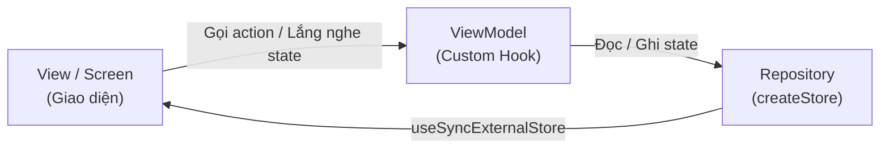

# Frontend MVVM Architecture Guide (`frontend/`)

Tài liệu chi tiết về kiến trúc MVVM, quản lý trạng thái và quy chuẩn kiểm thử cho ứng dụng di động DANANGACY (React Native + Expo).

---

## 1. Cấu trúc thư mục Feature

Mỗi module tính năng trong `src/features/<feature>/` phải tổ chức theo cấu trúc chuẩn:

```text
src/features/<feature>/
├── screens/          # View (Chỉ chứa giao diện, sự kiện)
├── components/       # Các UI Component riêng của tính năng
├── viewmodels/       # ViewModel (Custom Hooks quản lý logic màn hình)
├── repositories/     # Repository (Thao tác dữ liệu, Observable Store)
├── providers/        # Context Provider kết nối Repository với ViewModel
├── data/             # Dữ liệu khởi tạo hoặc demo
├── models/           # Hàm pure chuyển đổi dữ liệu (nếu có)
└── types.ts          # Định nghĩa kiểu dữ liệu TypeScript
```

---

## 2. Luồng dữ liệu bắt buộc (View → ViewModel → Repository)



1. **View (Screen):**
   - Chỉ render JSX và bắt sự kiện từ người dùng (nhấn nút, nhập văn bản).
   - **Tuyệt đối KHÔNG** gọi API mạng trực tiếp (fetch, axios).
   - **Tuyệt đối KHÔNG** mutate trực tiếp dữ liệu từ Store hay Repository.
   - Nhận dữ liệu và handler hoàn toàn từ ViewModel.

2. **ViewModel (Custom Hook):**
   - Đặt tên theo tiền tố `use<Feature>ViewModel` (ví dụ: `useItineraryViewModel`).
   - Quản lý trạng thái form cục bộ, kiểm tra hợp lệ dữ liệu (validation), điều hướng màn hình.
   - Gọi các hàm nghiệp vụ được cung cấp từ Repository.

3. **Repository & Quản lý State:**
   - Sử dụng `createStore` (`src/shared/state/createStore.ts`) để tạo store quan sát độc lập với React.
   - Cung cấp `getSnapshot` và `subscribe` để View/ViewModel quan sát bằng `useSyncExternalStore`.
   - Lưu trữ cục bộ qua AsyncStorage với khóa chuẩn:
     ```typescript
     const STORAGE_KEY = 'danangacy.demo.v1';
     ```

---

## 3. Lệnh kiểm tra chất lượng

Sau khi phát triển hoặc sửa đổi bất kỳ tệp nào trong `frontend/`, bắt buộc chạy hai lệnh kiểm thử sau:

```powershell
cd frontend
npm run typecheck     # Kiểm tra kiểu dữ liệu TypeScript (phải đạt 0 lỗi)
npm test              # Chạy 16 bài kiểm tra MVVM tự động (pass 16/16)
```
